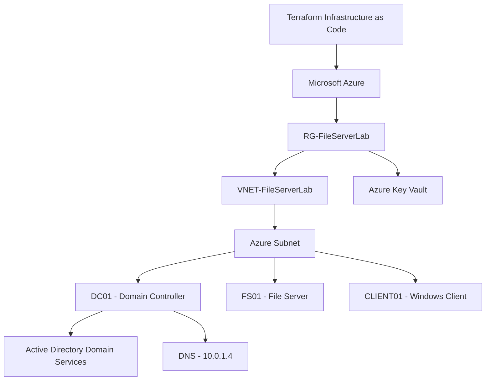
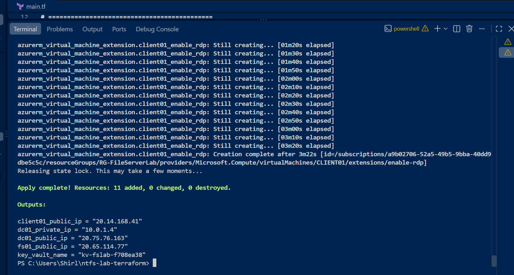
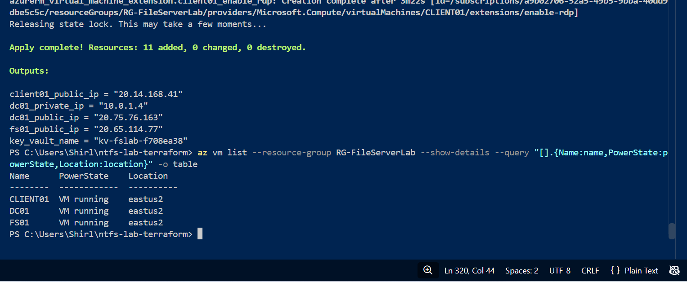
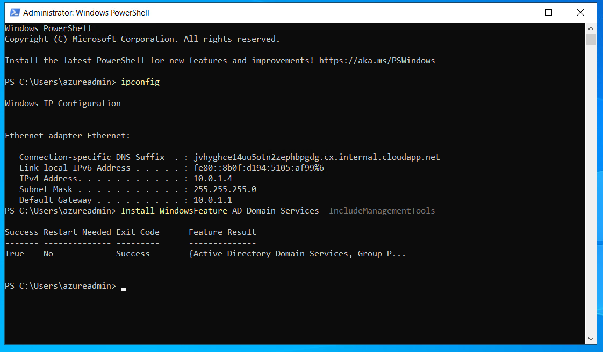
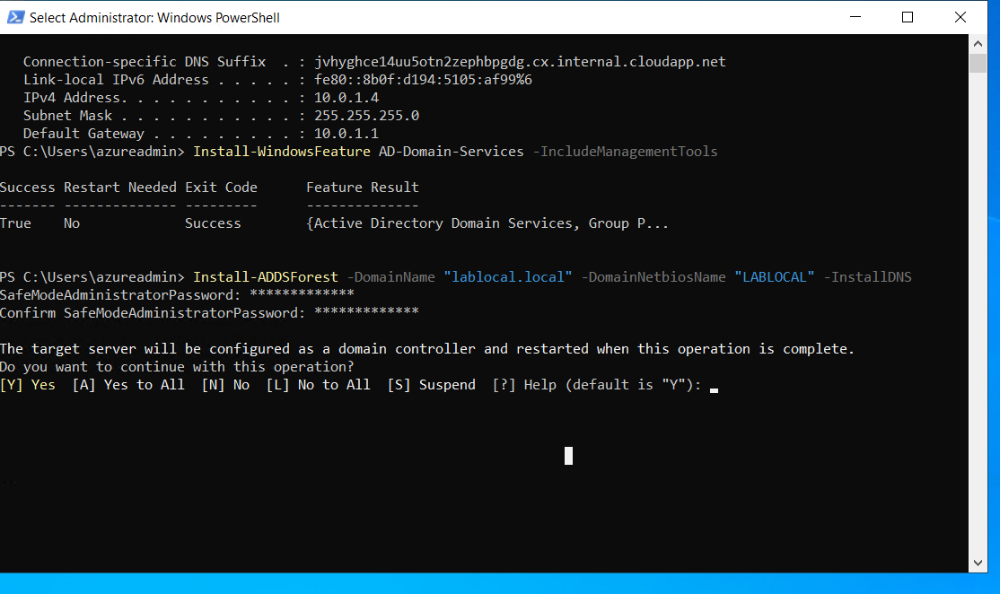
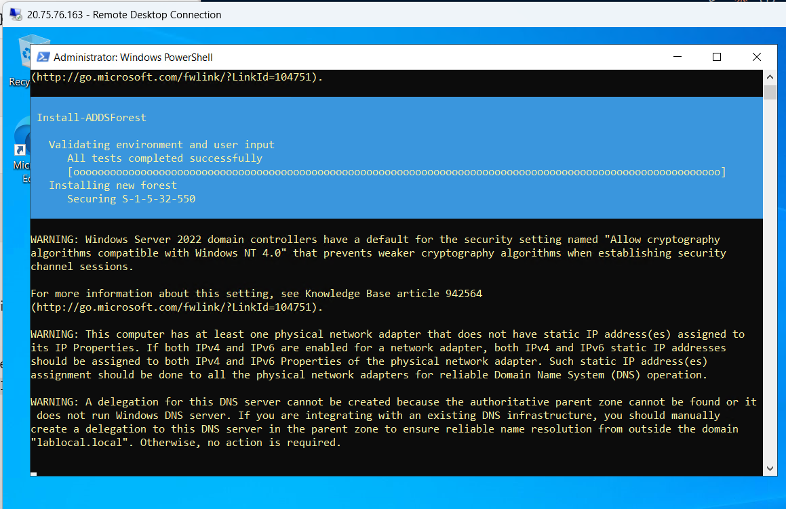
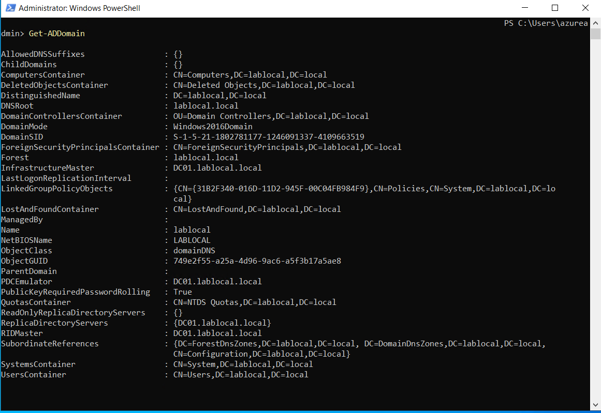
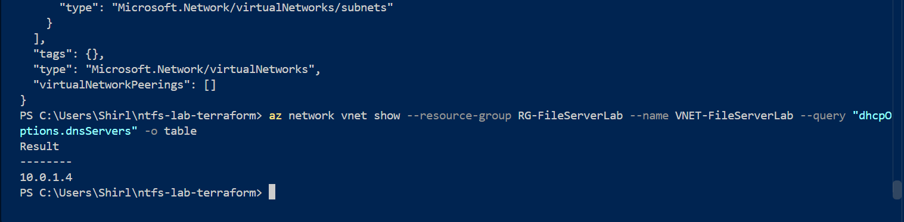
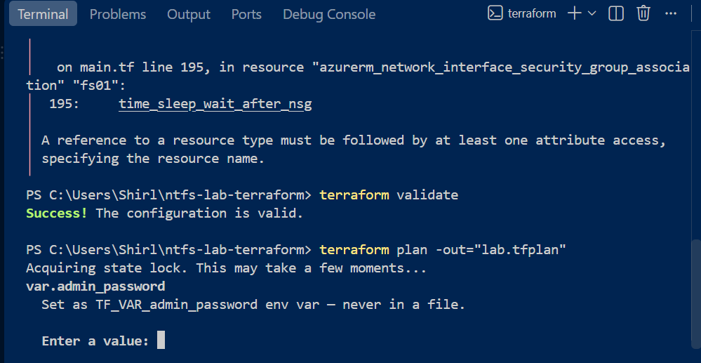

# Azure File Server Infrastructure Lab Using Terraform

## Project Overview

This project demonstrates the deployment and configuration of a Windows Server infrastructure environment in Microsoft Azure using Terraform Infrastructure as Code (IaC).

The lab was designed to simulate a small enterprise network consisting of a domain controller, file server, and Windows client workstation.

The infrastructure was provisioned using Terraform, with Azure resources configured to support centralized identity management, DNS, network security, and future file-sharing services.

### Project Objectives

- Automate Azure infrastructure deployment using Terraform.
- Deploy three Azure virtual machines: DC01, FS01, and CLIENT01.
- Configure Active Directory Domain Services (AD DS) and DNS.
- Establish virtual networking and network security controls.
- Use Azure Key Vault for administrative credential management.
- Configure private DNS resolution for domain-connected systems.
- Prepare the environment for Windows file sharing and NTFS permission management.
- Troubleshoot deployment failures, Azure resource restrictions, and Terraform state inconsistencies.

### Technologies Used

| Technology | Purpose |
|---|---|
| Microsoft Azure | Cloud infrastructure platform |
| Terraform | Infrastructure as Code |
| Azure Virtual Machines | Windows Server and client deployment |
| Windows Server 2022 | Domain controller and server operating system |
| Active Directory Domain Services | Centralized identity management |
| DNS | Domain name resolution |
| Azure Virtual Network | Private network connectivity |
| Network Security Groups | Network traffic filtering |
| Azure Key Vault | Administrative credential storage |
| Azure CLI | Resource management and troubleshooting |
| PowerShell | Windows Server configuration and validation |
| Git and GitHub | Version control and project documentation |

### Implementation Status

The Terraform deployment successfully provisioned the Azure infrastructure, including three running virtual machines.

Active Directory Domain Services was installed, and DC01 was promoted to a domain controller for the `lablocal.local` domain.

DNS was configured to use the domain controller's private IP address, `10.0.1.4`.

The environment is prepared for the remaining file server configuration and NTFS permissions exercises.

## Infrastructure Architecture

The lab uses a three-machine Windows infrastructure environment deployed in Microsoft Azure using Terraform.

### Azure Virtual Machines

| Virtual Machine | Role | Purpose |
|---|---|---|
| DC01 | Domain Controller | Hosts Active Directory Domain Services and DNS |
| FS01 | File Server | Intended to host shared folders and NTFS permissions |
| CLIENT01 | Windows Client | Used to test domain connectivity and access to shared resources |

### Network Configuration

| Component | Configuration |
|---|---|
| Azure Region | East US 2 |
| Resource Group | RG-FileServerLab |
| Virtual Network | VNET-FileServerLab |
| Domain | lablocal.local |
| Domain Controller Private IP | 10.0.1.4 |
| DNS Server | 10.0.1.4 |
| Network Security | Azure Network Security Group (NSG) |
| Credential Management | Azure Key Vault |

### Infrastructure Workflow

1. Terraform provisions the Azure resource group, virtual network, subnet, and network security resources.
2. Azure virtual machines are deployed for the domain controller, file server, and Windows client.
3. Azure Key Vault is provisioned for administrative credential management.
4. DC01 is configured with Active Directory Domain Services and DNS.
5. The Azure virtual network is configured to use DC01 as its DNS server.
6. FS01 and CLIENT01 are prepared for domain integration and file-sharing exercises.

### Infrastructure Diagram



The architecture provides the foundation for centralized identity management, domain-based authentication, and Windows file-sharing services.

## Terraform Deployment and Troubleshooting

### Deployment Overview

I used Terraform to provision and manage a Windows Server infrastructure environment in Microsoft Azure.

The deployment included three virtual machines, virtual networking, network security resources, and Azure Key Vault.

### Challenges and Resolutions

| Challenge | Troubleshooting and Resolution |
|---|---|
| Azure VM size availability | Reviewed VM sizes and Azure regional availability to identify suitable deployment options. |
| Terraform subnet state inconsistency | Compared Azure resources against Terraform state, removed the subnet from state, and generated a new deployment plan. |
| Terraform configuration validation | Used `terraform fmt` and `terraform validate` to check configuration formatting and syntax. |
| Domain Controller configuration | Installed Active Directory Domain Services and promoted DC01 to a domain controller. |
| DNS configuration | Configured the Azure virtual network to use the domain controller's private IP address, `10.0.1.4`, for DNS. |
| Virtual machine deployment | Verified that DC01, FS01, and CLIENT01 were running in Azure East US 2. |

### Terraform Commands Used

```powershell
terraform init
terraform fmt
terraform validate
terraform plan
terraform apply
terraform state list
```

### Deployment Results

The repaired Terraform deployment completed successfully with the following results:

- 11 resources added
- 0 resources changed
- 0 resources destroyed
- Three Azure virtual machines confirmed running
- Active Directory domain `lablocal.local` created
- DNS configured to use `10.0.1.4`
- Azure Key Vault provisioned

### Validation

I verified the Active Directory installation using:

```powershell
Get-ADDomain
```

I verified the Azure virtual machine deployment using:

```powershell
az vm list --resource-group RG-FileServerLab --show-details --output table
```

The results confirmed the deployed infrastructure and successful creation of the Active Directory domain.

## Screenshots and Deployment Evidence

The following screenshots document the Azure infrastructure deployment, Active Directory configuration, and Terraform validation.

### Terraform Deployment





### Active Directory Configuration







### Active Directory Domain Verification

The Active Directory domain was verified using the
Get-ADDomain PowerShell command.




### Azure Virtual Network DNS Configuration

Configured the Azure virtual network to use DC01
(10.0.1.4) as its DNS server to support Active
Directory domain name resolution.



### Infrastructure Validation

